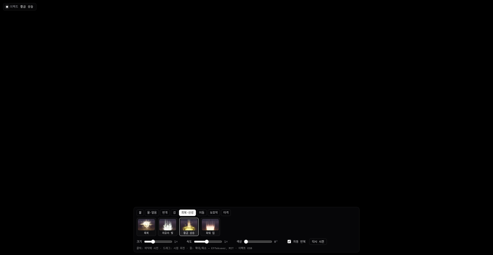

# Effekseer 이펙트 모음 (한글화)

[Patch](https://patch.gg/patch/effekseer)의 "effekseer" 블록을 한글화한 포크입니다. 웹에서 Effekseer 이펙트 33종(불, 번개, 물, 바람 등 8개 그룹)을 3D 장면에 재생해 볼 수 있습니다.

- 한글화 범위: 화면 문구(HUD, WebGL 안내), 이펙트 그룹/이름 라벨, 그리고 원본에서는 patch.gg 쪽에 있던 컨트롤을 대신하는 한국어 컨트롤 패널(그룹 탭, 이펙트 선택, 슬라이더, 다시 재생)
- 이펙트 파일, 이펙트 ID, 제작자 표기는 원본 그대로입니다.
- 원본 README는 [README.en.md](README.en.md)에 보관했습니다.

## 화면



위 캡처는 한국어 컨트롤 패널(그룹 탭, 이펙트 선택, 크기/속도/색상 슬라이더)만 보여 줍니다. 3D 이펙트 재생은 이 캡처에 포함되지 않았고, 촬영 환경에서는 원본과 한글판 모두 이펙트가 화면에 보이지 않아 효과 렌더링은 아직 검증하지 못했습니다.

## 실행

```
npm install
npm run dev     # 개발 서버
npm run build   # dist/ 생성
```

WebGL 2가 되는 브라우저가 필요합니다.

## 라이선스와 출처

| 항목 | 라이선스 |
| --- | --- |
| Effekseer 웹 런타임 1.80.8 | MIT (`vendor/effekseer/LICENSE`) |
| 이펙트 33종 (Pierre, NextSoft, AndrewFM, Suzuki, tktk, Effekseer 프로젝트) | CC0 |
| 바닥 monastery_stone_floor (Amal Kumar), 하늘 qwantani_dusk_2_puresky | CC0 (Poly Haven) |
| three.js | MIT |
| Red Hat Mono | SIL OFL 1.1 |
| 데모와 래퍼 (Patch) | MIT |
| 썸네일 | CC0 |

자세한 내용은 `LICENCE-NOTES.md`, `CREDITS.txt`를 보세요. 원본: https://patch.gg/patch/effekseer
